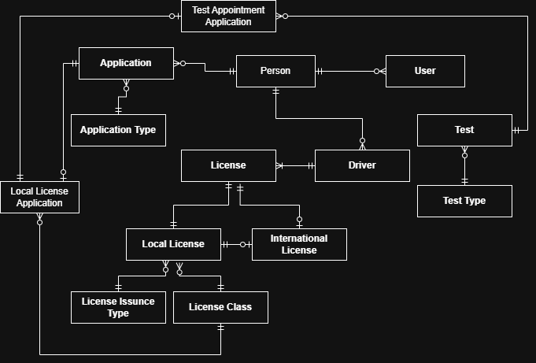
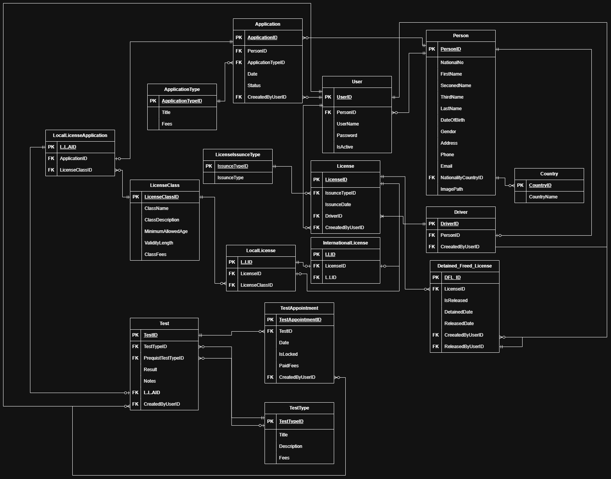

# DVLD System Architecture
The __DVLD__ project follows a __*3- Tier Architecture*__, which separates the application into three main layers

### 1- __Data Access Layer (DVLD_DataAccess):__  
This layer is responsible for communicating with the database, using **Microsoft SQL Server** and **ADO.NET** for connectivity. It handles operations such as retrieving, inserting, updating, and deleting data. It contains the database-related logic, keeping it separate from the business rules and user interface.

### 2- __Business Layer (DVLD_Business)__:
This layer contains the application's business logic and rules. It acts as a bridge between the Data Access Layer and the Presentation Layer. It validates data, applies business rules, and coordinates operations before requesting the Data Access Layer to interact with the database.

### 3- __Presentation Layer (DVLD_Presentation)__:
This is the layer that users interact with. It is responsible for displaying information, receiving user input, and presenting the results of operations using **WinForms**. It communicates with the Business Layer rather than accessing the database directly.

### 4- __Testing Project (Console)__:
In addition to the three main layers, I use a Console application to test the Data Access and Business layers independently. This allows me to verify that database operations and business logic work correctly before integrating them into the main Presentation Layer.

### __Communication Between Layers:__

The general flow of the application is:  
<mark>Presentation → Business → Data Access → Database</mark>

### __Data Base Design__

#### __Conceptual Design:__

#### __Logical Design:__

